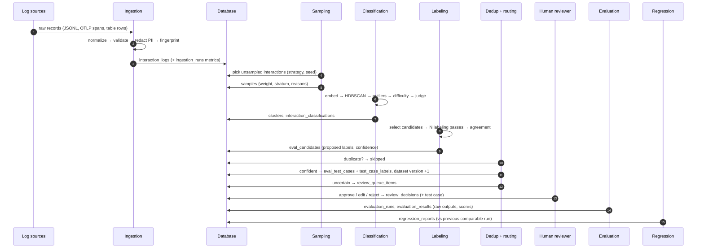
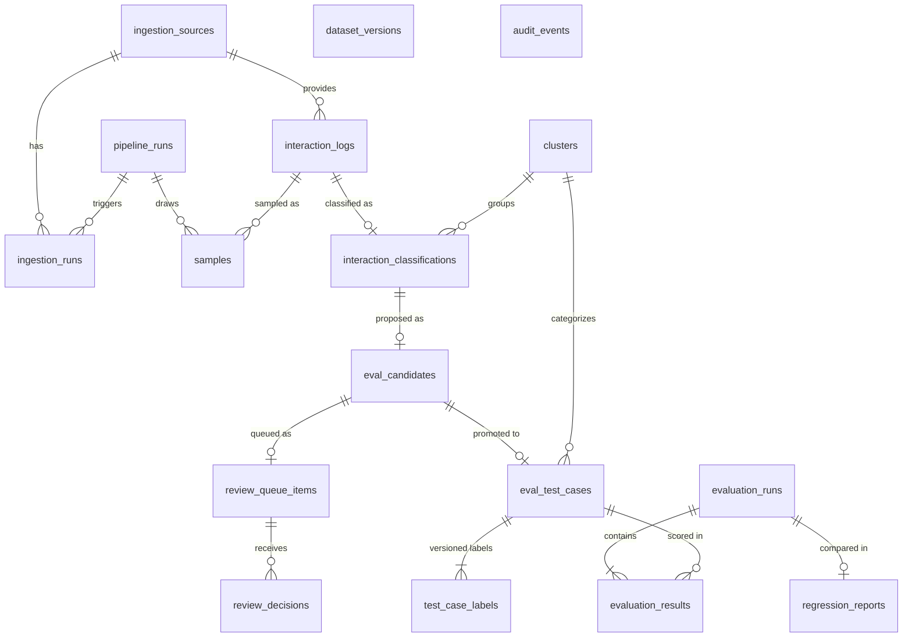

# EvalForge architecture

## 1. Data flow: raw logs to curated eval cases

Every stage is a service with injected dependencies (`evalforge.container.build_container`),
runs in its own transaction, and writes its result into `pipeline_runs.stage_results`.

### Canonical record

All sources are normalized to `LLMInteraction` (`evalforge/domain/schemas.py`): `id`,
`timestamp`, `application_feature`, `model_name`, `system_prompt`, `user_prompt`,
`raw_response`, `latency_ms`, `input_tokens`, `output_tokens`, `error_status`,
`user_feedback`, `retry_count`, `response_length`, `content_filter_triggered`,
`confidence_score`, `metadata`, `redaction_status`, `ingested_at`. The model forbids unknown
fields, coerces timestamps to UTC and validates ranges; adapters move unknown upstream keys
into `metadata`.

## 2. Stage workflows

### Ingestion (`services/ingestion.py`, `adapters/sources/`)

- **Adapters** implement `LogSourceAdapter.read(since, until)` and yield `RawRecord`s, each
  either a validated interaction or an error. Three ship: `json_logs` (JSON/JSONL with field
  aliases), `otel_traces` (OTLP/JSON, GenAI semantic-convention attributes, non-LLM spans
  ignored) and `database` (any SQLAlchemy URL, table name validated, column map).
- Per record: validate → redact → fingerprint → skip if seen in this batch or already stored
  → insert inside a savepoint (one bad row cannot poison the batch).
- Metrics stored per run: received, accepted, rejected, duplicates, redactions, failures,
  plus up to 50 error details.
- Incremental: each source keeps `cursor_timestamp`; the next run reads from the cursor minus
  a 30-minute overlap up to "now".

### Sampling (`services/sampling.py`)

Pure functions over lightweight `SamplingRow`s, all seeded:

| Strategy | Behaviour |
| --- | --- |
| `uniform` | Random sample without replacement |
| `stratified` | Strata from feature × model × error status × feedback; proportional allocation by largest remainder with at least one row per stratum |
| `signal_boosted` | Weight = 1 + boosts for negative feedback, retries, high latency, low confidence, content-filter events, errors, unusual response length and under-represented features; weighted sampling without replacement |

Each `samples` row stores strategy, seed, weight, stratum and the list of reasons, so "why was
this sampled?" is always answerable. Sampling is idempotent per pipeline run.

### Classification (`services/classification.py`, `services/clustering.py`)

1. **Embed** prompts and responses (`EmbeddingClient`).
2. **Cluster**: L2-normalize, PCA to 15 dimensions, HDBSCAN (leaf selection) over the new
   vectors plus up to `context_window` earlier ones. Each group maps to a persistent cluster
   by majority vote of already-labelled members, else by centroid similarity
   (`match_threshold`), else it becomes a new cluster if it is cohesive enough
   (`min_cohesion`). Noise points attach to the nearest cluster above `assign_threshold` or
   stay unclustered (novel). Earlier novel interactions are assigned late when a cluster forms
   around them. New clusters are named by the LLM from representative prompts, or
   deterministically from their most frequent content words.
3. **Outliers** (`OutlierReason`): novel prompt, low confidence, immediate retry, rephrased
   prompt (same session, within 10 minutes, similar embedding), unusually long/short response
   (absolute bounds or robust z-score), content-filter trigger, negative feedback.
4. **Difficulty**: `adversarial` (injection/unsafe patterns, content filter), `hard`
   (ambiguous, multi-part, domain terms, very long), `moderate` (reasoning words, code or
   generation, long), else `simple`, with confidence and signals.
5. **Quality judge**: helpfulness, accuracy, completeness (1-5), confidence and rationale.
   LLM-as-judge when configured; offline a rule set over behaviour (refused an attack?
   clarified an ambiguous request?), production signals and source-document grounding.

Everything is stored on `interaction_classifications` with the embedding model, judge model,
classifier version and timestamp.

### Labeling (`services/labeling.py`, `services/labelers.py`)

1. **Select** candidates (`select_candidate`): outliers, clear failures and strong exemplars;
   priority adds outlier count, failure/exemplar bonus, adversarial bonus and the cluster's
   coverage deficit. Top `max_candidates_per_run` are processed.
2. **Pre-dedup** against active test cases.
3. **Label** in `passes` passes. Each pass yields a `LabelSet`: question type, expected
   behaviour, expected quality, required assertions, forbidden assertions (hallucination
   traps), reference answer (factual) and/or rubric, category, difficulty, confidence.
   - Factual with a source document: the reference must be supported by the source
     (`verify_against_source`); unsupported figures in the production response become
     forbidden assertions.
   - Subjective/open-ended, refusal and clarification cases get a rubric.
   - The LLM labeler asks for step-by-step reasoning followed by the JSON fields.
4. **Aggregate** (`aggregate_passes`): majority behaviour, median quality, majority
   assertions; agreement and conflicts are computed and stored with every pass.

### Deduplication and routing (`services/dedup.py`)

In priority order, each labeled candidate is compared (cosine similarity of prompt
embeddings) with active test cases and candidates already in review. Above the threshold
(default 0.92) it is marked `duplicate`. Otherwise confidence ≥ `auto_accept_confidence` and
no conflicts → test case (`auto_labeled`); anything else → review queue with the reason. One
dataset version is created per batch.

### Review (`services/review.py`)

`approve`, `edit` (partial `LabelEdit`), `reject`, `annotate`; plus `edit_test_case`,
`add_note`, `retire_test_case` for existing cases. Every action writes a `review_decisions`
row and an audit event; approvals create a `human_reviewed` test case and bump the dataset
version. Similar existing cases are retrieved for reviewer context.

## 3. Database schema

| Table | Purpose | Notable constraints and indexes |
| --- | --- | --- |
| `ingestion_sources` | Configured sources and cursors | unique `name` |
| `ingestion_runs` | Per-source ingestion metrics | index on `source_id`, `started_at` |
| `interaction_logs` | Normalized, redacted log store | unique `fingerprint`; indexes on `timestamp`, `(application_feature, timestamp)`, `(model_name, timestamp)`, `user_feedback`, `error_status` |
| `pipeline_runs` | Run status, stages, per-stage results | index on `status`, `started_at`, `correlation_id` |
| `samples` | Why each interaction was sampled | unique `(pipeline_run_id, interaction_id)` |
| `clusters` | Persistent categories with centroid | unique `name` |
| `interaction_classifications` | Classifier outputs + embeddings | unique `interaction_id`; index `(cluster_id, difficulty)`, `quality_score`, `is_outlier` |
| `eval_candidates` | Proposed cases, label passes, routing | unique `interaction_id`; index on `status` |
| `eval_test_cases` | The dataset | unique `content_hash`, unique `candidate_id`; indexes `(category, difficulty)`, `(status, created_at)`, `source` |
| `test_case_labels` | Versioned labels | unique `(test_case_id, version)` |
| `review_queue_items` | Human review queue | unique `candidate_id`; index `(status, priority)` |
| `review_decisions` | Append-only reviewer actions | index `(reviewer, created_at)` |
| `evaluation_runs` | Run config, versions, report | index `(comparison_group, started_at)` |
| `evaluation_results` | Raw output and scores per case | unique `(run_id, test_case_id)`; index `(run_id, passed)` |
| `regression_reports` | One per run with a baseline | unique `run_id` |
| `dataset_versions` | Monotonic dataset version log | primary key `version` |
| `audit_events` | Append-only audit trail | index `(entity_type, entity_id)`, `timestamp`, `action` |

All timestamps are timezone-aware UTC. Flexible payloads are `JSONB` on PostgreSQL. Foreign
keys cascade or null out explicitly. The initial migration is
`migrations/versions/20261115_0001_initial_schema.py`; CI runs `alembic check` to make sure
models and migrations agree.

## 4. API design

- FastAPI application factory (`evalforge.api.app.create_app`), routers per resource group
  under `/api/v1`, Pydantic request and response models, OpenAPI at `/docs`.
- Resource-oriented REST: `POST` creates/triggers (201), `GET` lists or retrieves, `PATCH`
  edits labels. Offset pagination with `limit`/`offset` and a `{items, total, limit, offset}`
  envelope; filters as query parameters.
- One error envelope for every failure: `{"error": {code, message, correlation_id, details}}`
  with 400 (invalid request), 401, 404, 409 (conflict), 422 (validation), 500.
- Request-scoped transactional session; domain exceptions (`NotFoundError`, `ConflictError`,
  `InvalidRequestError`) map to status codes in one place.
- Correlation ID middleware: accepts or generates `X-Correlation-ID`, binds it to the log
  context, returns it in the response and in error bodies.
- Write endpoints depend on `require_write_access` (see Privacy and security).

## 5. Evaluation and regression logic

**Runner** (`services/evaluation.py`): loads active cases with their current labels, calls the
endpoint concurrently (`asyncio` + semaphore, retries with exponential backoff in the client),
captures raw text, latency, tokens, retries and errors, scores each response and stores one
immutable `evaluation_results` row per case. The run stores endpoint config (the API key is
referenced by env-var name only), dataset version, code version, grading mode and the report.

**Scoring** (`services/scoring.py`):

1. Detect behaviour (refusal / clarification / answer).
2. Check required and forbidden assertions.
3. Content score: token-F1 against the reference (scaled) or weighted rubric keyword coverage.
4. Deterministic quality = `1 + 4·(0.30·behaviour + 0.35·required + 0.15·forbidden + 0.20·content)`,
   capped at 2 on a behaviour mismatch and at 3 when forbidden content is present.
5. In `llm`/`hybrid` mode the judge's helpfulness/accuracy/completeness replace or are averaged
   with the deterministic score and decide `concept` assertions.
6. Pass = behaviour matches ∧ all required hold ∧ no forbidden ∧ quality ≥ expected − tolerance.

**Report**: overall pass rate and average quality; by category; by difficulty; by metric;
failed cases with reasons; tokens, estimated cost, runtime, latency percentiles.

**Regression** (`services/regression.py`): `compare_outcomes` is a pure function over the
cases shared by the run and its baseline. It lists new failures, newly passing cases, score
changes ≥ threshold, and category/difficulty pass-rate shifts ≥ threshold (groups of at least
`min_group_size`), and assigns a severity. Reports are created once per run and never updated.

## 6. Privacy and PII handling

- Redaction happens **inside ingestion, before the first write**. There is no code path that
  persists an interaction without passing through `Redactor` (when disabled by configuration
  the row is explicitly marked `redaction_status = "skipped"`).
- Layers: ordered regex rules (API keys, emails, IBANs, Luhn-valid card numbers, SSNs, phone
  numbers, IP addresses) → custom rules → pluggable entity recognizer (default: person names
  from introductions, titles and salutations). Metadata is redacted recursively and a
  configurable set of keys (`user_email`, `user_name`, `ip`, `phone`, `address`) is dropped.
- Fingerprints are computed on redacted content. Error details for rejected records keep
  validation messages and a short excerpt only. Logs carry IDs, counts and error types, not
  prompt or response text.
- Secrets: API keys are read from environment variables named in configuration; they are not
  stored in settings objects, the database or run records.
- Authorization: `local_dev` (documented open mode) or shared-token mode with constant-time
  comparison for all write endpoints and dashboard actions.
- Known gaps: names without a cue ("ask Priya"), free-text addresses, and identifiers specific
  to your business. Add custom rules or inject a stronger recognizer; consider restricting
  which metadata keys are accepted at all.
- Downstream model calls (judge, labeler, evaluation target) only ever see redacted text.

## 7. Scaling considerations

| Concern | Current design | Path for high volume |
| --- | --- | --- |
| Log volume | PostgreSQL table, batched inserts, fingerprint lookup in chunks | Partition `interaction_logs` by day; or move it to ClickHouse (the table is append-only and referenced by ID only), keeping application tables in PostgreSQL |
| Ingestion | Pull from files/tables with a cursor | Streaming adapter (Kafka, OTLP receiver); parallelize per source |
| Sampling | Loads eligible rows into memory | Push weights into SQL (`ORDER BY -ln(random())/weight LIMIT n`) or sample per partition; bound with `lookback_days` |
| Embeddings | JSON arrays; brute-force similarity in NumPy | `pgvector` column + HNSW index behind `SimilarityIndex`; batch embedding with a cache keyed by content hash |
| Clustering | HDBSCAN over new points + a 2,000-point context window | Keep the window bounded; periodic offline re-clustering of a larger sample; incremental assignment to centroids in between |
| Labeling cost | Cap per run, pre-dedup before labeling | Cheaper first-pass model with escalation, prompt caching, batch APIs |
| Evaluation | Async with a concurrency limit, results held in memory then written | Stream results to the database, shard the dataset across workers |
| API latency | Pipeline and evaluation calls are synchronous | Job queue (Celery/Arq) with `202 Accepted` and status polling |
| Dashboard | Queries on demand; metrics scan test cases in Python | Materialized views or a metrics table refreshed by the pipeline |
| Scheduler | Single APScheduler process | Leader election or a database advisory lock; or an external scheduler (Kubernetes CronJob, Airflow) |

## 8. Failure modes and operational monitoring

| Failure | Behaviour | What to watch |
| --- | --- | --- |
| Source unreadable (missing file, bad DSN) | That ingestion run is `failed` with the error; other sources and stages continue | `ingestion_runs.status`, `failures` |
| Malformed or invalid records | Counted as rejected with details; run continues | Rejection rate per source (schema drift) |
| Duplicate deliveries | Dropped by fingerprint | Duplicate rate |
| Redaction miss | Not detectable automatically | Periodic sampling of stored text; `redactions` trend falling to zero is suspicious |
| Embedding / judge / labeler outage or bad JSON | Role falls back to its heuristic, warning logged, model name records the fallback | Log events `*.fallback`, `clustering.llm_naming_failed`; share of rows with a heuristic model name |
| Stage crash | Run marked `failed` with the stage and error; earlier stages stay committed; resume re-runs only what is missing | `pipeline_runs.status`, `error`; `pipeline.stage_failed` log event |
| Evaluated endpoint errors or timeouts | Per-case failed result with the error; run completes | `report.overall.errors`, `usage.retries` |
| Cluster drift / mixed clusters | Cohesion and membership thresholds limit it | Cluster count and sizes over time; share of unclustered traffic |
| Review backlog | Queue grows | `metrics/quality.review_queue_pending`, auto-accept rate |
| Label quality drift | Reviewers edit or reject more | `auto_label_accuracy_reviewed`, inter-annotator agreement |
| Dataset staleness or imbalance | Fewer new cases, sparse clusters | `metrics/freshness`, `metrics/coverage.sparse_clusters` |
| Model regression | Regression report with severity | `regression_reports.has_regression`, severity `major` |

**Observability.** Structured JSON logs (structlog) with a correlation ID bound per pipeline
run, evaluation run and API request; the same ID is stored on `pipeline_runs`,
`ingestion_runs`, `evaluation_runs` and `audit_events`. `GET /health` is a liveness probe and
`GET /ready` checks database connectivity. `audit_events` records every state-changing action
(ingestion, dataset changes, review decisions, evaluations, regression reports) with the actor.
